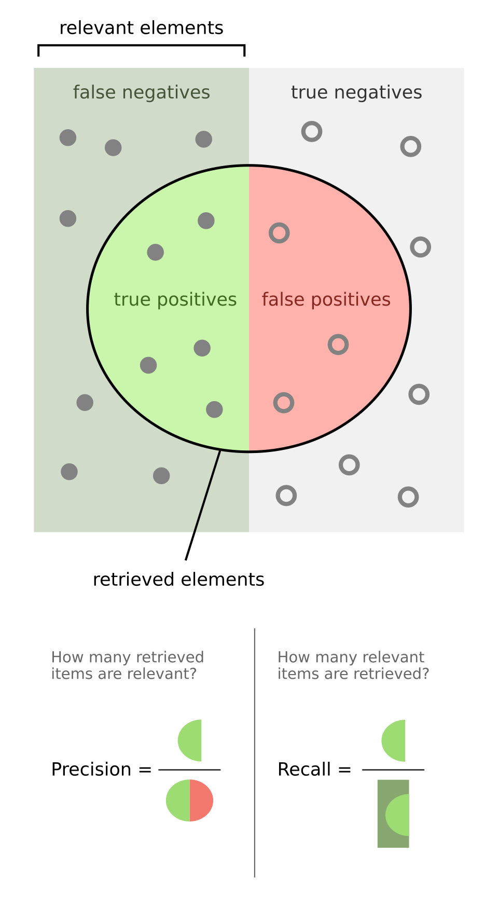

在統計學 Precision 又稱為型一錯誤 (Type I Error) 或偽陽性， Recall 則是型二錯誤（Type II Error）或偽陰性。道理我都懂，但實在太容易講反了，舉幾個例子先：

```
情境： SRE / 告警系統
假設： 系統裡 `真的有 100 次事故`，告警系統「叫了 50 次」。其中 40 次是真的事故，10 次是誤報

Precision（準不準）= 40/50
# 我叫的這 50 次裡，有幾次是真的？

Recall（有沒有漏） = 40/100
# 真的 100 次事故，我抓到幾次？
```

這概念可以套用在不同場景，會有不同解讀空間

| 場景     | 在做什麼 | 問題本質   | 該用的敘事       |
| -------- | -------- | ---------- | ---------------- |
| 抽樣統計 | 看世界   | 世界不完整 | **母體 / 樣本**  |
| 訓練     | 學規則   | 能力上限   | **訊號 vs 雜訊** |
| 推論     | 下判斷   | 決策邊界   | **門檻 / 分數**  |
| 應用     | 承擔後果 | 錯誤成本   | **風險分配**     |
